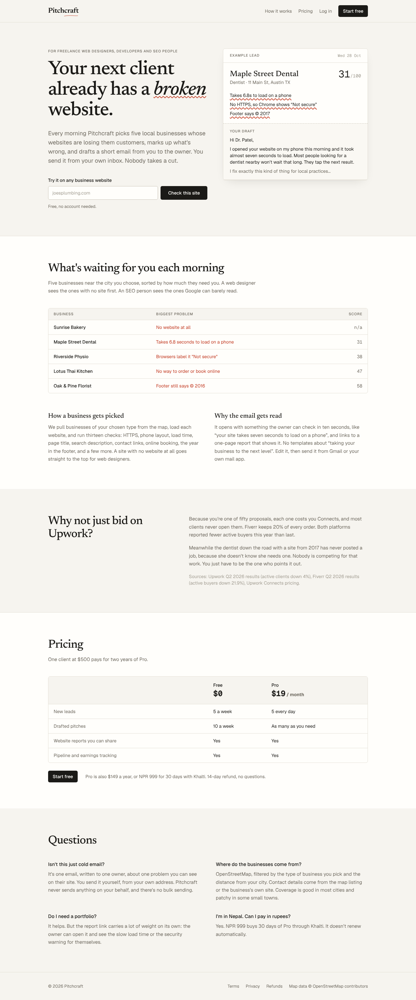

# Pitchcraft

Pitchcraft finds local businesses whose websites are losing them customers, audits each site, and drafts a short email a freelancer can send the owner. The freelancer wins the work directly and keeps all of it. Pitchcraft charges a subscription: $19 a month, or NPR 999 for 30 days through Khalti.

The market research behind the idea is in [`research/consumer-earning-app-research.md`](research/consumer-earning-app-research.md).



Screenshots of the [dashboard](docs/screenshots/desktop-dashboard.png), a [lead](docs/screenshots/desktop-lead.png) and the [home page on a phone](docs/screenshots/mobile-landing.png) are in `docs/screenshots`, along with the client work: [quote](docs/screenshots/desktop-quote.png) and [what the client sees](docs/screenshots/desktop-client-quote.png), [site builder](docs/screenshots/desktop-site-builder.png) and [the finished site](docs/screenshots/desktop-client-site.png), [results and care plan](docs/screenshots/desktop-care.png), [before-and-after report](docs/screenshots/desktop-client-before-after.png), [invoice](docs/screenshots/desktop-client-invoice.png), [clients](docs/screenshots/desktop-clients.png), [a conversation](docs/screenshots/desktop-conversation.png) and the [inbox](docs/screenshots/desktop-inbox.png).

## How it works

1. A freelancer picks a skill, a type of business and a city.
2. Every morning a cron job pulls matching businesses from Google Maps (or OpenStreetMap, if no Google key is set) and fetches each website. It runs 13 checks (HTTPS, mobile viewport, response time, title, description, contact links, booking, footer year and so on), plus Google PageSpeed when a key is set.
3. The businesses are ranked for that freelancer's skill. A web designer sees businesses with no website first. An SEO freelancer sees sites Google can barely read.
4. For each lead the freelancer can draft an email. Claude writes it from the audit findings; without an API key, a hand-written template per finding does the job. The email links to a public report the owner can open.
5. The freelancer edits and sends it from the lead's page. It goes out as "Their Name via Pitchcraft", and the business's reply comes back into the app: onto the lead's conversation, into the Inbox, and as an email alert. The lead moves to Emailed, then Replied, on its own. Three days after an unanswered email, the lead shows up under "Follow up today" with a follow-up already drafted.

### After the client says yes

Each lead has a workspace with five tabs, so the freelancer does the actual work in the app:

- **Quote.** Built from the audit: one priced line per problem (or a new site plus hosting when there's no website), at Kathmandu rates for NPR and typical rates elsewhere. The freelancer edits it and sends a link (`/q/:id`). The client accepts by typing their name; the lead becomes won with the quote's total, and the freelancer gets an email.
- **Website.** A one-page site builder with four templates (clinic, restaurant, guesthouse, shop), five colours, services, hours, WhatsApp, a map link and a booking form. It starts filled in from the lead's details and previews live as you type. Publishing puts it at `/s/:slug`, where booking requests are stored and emailed to the business and the freelancer. It can also be downloaded as one HTML file to host anywhere. The generated HTML passes every check in Pitchcraft's own audit.
- **Results & care.** A before-and-after report (`/p/:id`) compares the audit we pitched with a fresh check of the finished site. A monitor checks the site every 10 minutes and emails the freelancer when it's down (after two failed checks) and when its HTTPS certificate has 14 days left. The client gets a health report at `/m/:id`: uptime, response time, certificate and outages over 30 days. That's the monthly care plan the freelancer sells.
- **Invoices.** Prefilled from the accepted quote, numbered INV-0001 onwards per freelancer. The public invoice (`/i/:id`) prints cleanly and shows the freelancer's own eSewa, Khalti, bank, Payoneer details and payment QR from Settings. **Pitchcraft never holds or moves the money**; the freelancer marks the invoice paid.
- **Clients** (`/app/clients`) lists every won client with their site, care plan and what they still owe.

## Stack

Next.js 16 (App Router, server actions), TypeScript, Tailwind 4, Postgres with Drizzle, the Anthropic SDK, Vitest and Playwright.

The code is organised like this:

```
src/
  app/                pages, server actions (app/actions) and route handlers (app/api)
    app/              signed-in area: today, pipeline, settings, billing, leads/[id]
    r/[id]/           public audit report
  components/         UI
  db/                 Drizzle schema and client
  lib/
    audit/            SSRF-safe fetch, HTML checks, scoring, PageSpeed
    leads/            Google Places, OpenStreetMap and mock providers, niches, ranking
    pitch/            Claude pitch writer and template fallback
    billing/          Paddle signature checks and cancellation, Khalti client
    services/         database-backed operations
    email.ts          Resend sender and templates
drizzle/              SQL migrations
tests/                unit tests; tests/integration runs against Postgres
e2e/                  Playwright tests, fixture websites, fake Khalti
```

## Running it locally

You need Node 20+ and Postgres.

```bash
npm install
cp .env.example .env   # set DATABASE_URL at minimum
npm run db:migrate
npm run dev
```

To work offline with fake businesses, set `LEADS_PROVIDER=mock` and `AUDIT_ALLOW_PRIVATE_HOSTS=1`, then run `node e2e/fixture-sites/server.mjs` in a second terminal. Without `RESEND_API_KEY`, emails are printed to the console, so you can follow reset and confirmation links from there.

## Configuration

Every variable is listed in [`.env.example`](.env.example). These matter most:

| Variable | Needed for |
|---|---|
| `DATABASE_URL`, `APP_URL`, `CRON_JOB_SECRET` | Always |
| `GOOGLE_MAPS_API_KEY` | Finding businesses on Google Maps. Without it the app falls back to OpenStreetMap. |
| `OSM_CONTACT_EMAIL` | Only with OpenStreetMap. Use your real address: Nominatim blocks requests without one. |
| `ANTHROPIC_API_KEY`, `PITCH_MODEL` | AI-written emails. Defaults to `claude-opus-5-5`, about a cent per draft. `claude-haiku-5-5` costs far less. |
| `PAGESPEED_API_KEY` | Google's phone speed score. The keyless quota is tiny. |
| `RESEND_API_KEY`, `EMAIL_FROM` | All email: account emails, and emails freelancers send to businesses |
| `OUTREACH_FROM_ADDRESS`, `REPLY_DOMAIN`, `RESEND_WEBHOOK_SECRET` | Sending to businesses as "Name via Pitchcraft" and bringing their replies back into the app |
| `LEGAL_OPERATOR_NAME`, `SUPPORT_EMAIL`, `LEGAL_COUNTRY` | The Terms, Privacy and Refund pages |
| `NEXT_PUBLIC_PADDLE_*`, `PADDLE_WEBHOOK_SECRET`, `PADDLE_API_KEY` | Card payments |
| `KHALTI_SECRET_KEY` | Payments in Nepal |

## Deploying

Vercel plus Neon or Supabase is the simplest setup.

1. Create the database and run `DATABASE_URL=... npm run db:migrate`.
2. Import the repo into Vercel and add the variables above. Use the Pro plan, because Hobby doesn't allow commercial use.
3. Schedule the background jobs with [cron-job.org](https://cron-job.org) (see below).

**Scheduled jobs (cron-job.org).** Two jobs keep Pitchcraft running. Set `CRON_JOB_SECRET` to a long random value (`openssl rand -hex 32`), then create two cron jobs at cron-job.org:

| Title | URL | Schedule |
|---|---|---|
| Pitchcraft daily | `https://YOUR-DOMAIN/api/cron-job/daily` | Every day at 01:17 UTC |
| Pitchcraft monitors | `https://YOUR-DOMAIN/api/cron-job/monitors` | Every 10 minutes |

- **Daily:** new leads for every user, refreshes Google data older than 29 days, and sends follow-up reminder emails.
- **Monitors:** checks every client site on a care plan and emails the freelancer about outages and expiring certificates.

For each job, open the **Advanced** tab and add a request header `Authorization` with the value `Bearer YOUR_CRON_JOB_SECRET`. If you'd rather not use headers, add `?key=YOUR_CRON_JOB_SECRET` to the URL instead. It works the same, but the key then appears in cron-job.org's history.

The route answers at once with `202` and runs the job in the background, because cron-job.org stops waiting after 30 seconds. Results go to the server logs (Vercel: Logs, filter on `cron-job`). To run a job by hand and see its result, add `wait=1`:

```bash
curl -H "Authorization: Bearer $CRON_JOB_SECRET" "https://YOUR-DOMAIN/api/cron-job/daily?wait=1"
```

A wrong or missing key gets `401`; an unknown job name gets `404`. The older `/api/cron/daily-leads` and `/api/cron/monitors` routes still exist for Vercel Cron and use `CRON_SECRET`. Use one scheduler or the other, not both, or follow-up emails go out twice.

**Paddle.** Nepal isn't on Paddle's blocked list, but confirm with their support before you rely on it. Then:
1. Create a product with a $19 monthly and a $149 yearly price, and put the price IDs in `NEXT_PUBLIC_PADDLE_PRICE_MONTHLY` and `NEXT_PUBLIC_PADDLE_PRICE_YEARLY`.
2. Create a client-side token for `NEXT_PUBLIC_PADDLE_CLIENT_TOKEN`.
3. Create a server API key that can write subscriptions, for `PADDLE_API_KEY`.
4. Point a notification destination at `/api/webhooks/paddle` for `subscription.*` and `transaction.completed`, and put its secret in `PADDLE_WEBHOOK_SECRET`.

Paddle reviews `/terms`, `/privacy` and `/refund` during approval.

**Khalti.** Live payouts need a registered firm and a PAN. The sandbox at test-admin.khalti.com is enough to test. The return URL is `/api/billing/khalti/callback`, and each payment adds 30 days of Pro.

**Resend (sending and receiving email).** Freelancers send every email from inside the app, and replies come back into it. Use subdomains, so a spam complaint can never touch your main domain's email:

1. **Sending.** In Resend, add and verify `mail.yourdomain.com` (Resend shows the SPF, DKIM and DMARC records to add). Set:
   - `RESEND_API_KEY`
   - `EMAIL_FROM=Pitchcraft <hello@mail.yourdomain.com>` for account emails
   - `OUTREACH_FROM_ADDRESS=outreach@mail.yourdomain.com`. Freelancers' emails go out as "Kushal Budhathoki via Pitchcraft <outreach@mail.yourdomain.com>".
2. **Receiving replies.** In Resend, under Receiving, add `reply.yourdomain.com` and create the MX record it shows. Set `REPLY_DOMAIN=reply.yourdomain.com`. Each email's Reply-To is `reply+<lead token>@reply.yourdomain.com`, which is how a reply finds its lead.
3. **Webhook.** In Resend, under Webhooks, add `https://YOUR-DOMAIN/api/webhooks/resend` with the events `email.received`, `email.bounced` and `email.complained`. Put its signing secret (`whsec_...`) in `RESEND_WEBHOOK_SECRET`.

Without `REPLY_DOMAIN`, sending still works and replies go to the freelancer's own inbox instead of the app.

Resend's free plan covers 3,000 emails a month (100 a day); the $20 plan covers 50,000.

**Google Maps.**
1. In Google Cloud Console, create a project and attach a billing account. Google requires a card even for free usage.
2. Enable **Places API (New)**. The older "Places API" is a different product and won't work.
3. Under Credentials, create an API key. Restrict it to Places API (New) and keep it server-side. Then set `GOOGLE_MAPS_API_KEY`.
4. Set a daily quota on the API in Cloud Console, so a bug can't run up a bill.

Cost: searches ask for website and phone, so they're billed at the Enterprise rate, about $35 per 1,000 requests after the first 1,000 free each month. One delivery uses 1 to 3 requests, so a Pro user costs roughly $1 to $3 a month.

Google only allows its business details to be cached for 30 days. The daily job re-fetches Google leads older than 29 days, and so does opening one. Pages that show Google data credit Google Maps.

**OpenStreetMap troubleshooting.** OpenStreetMap is free, but its public servers are shared and often busy. The app handles this in three ways:
- It tries three Overpass servers in turn.
- It treats a "query timed out" answer as a failure, not as an empty area.
- If Nominatim refuses a city lookup, it uses Photon instead.

If leads still don't come through, run this on the machine that has the problem:

```bash
npm run check:osm -- "Kathmandu, Nepal" dentist 5
```

It prints what every server answered. Common causes:
- **No contact email.** Set `OSM_CONTACT_EMAIL` to a real address.
- **All servers busy or blocking cloud hosts.** Wait, set `OVERPASS_URL` to another or your own Overpass server, or switch to Google Maps with `GOOGLE_MAPS_API_KEY`.
- **Radius too large.** A big radius in a dense city can time out; 5 to 10 km is plenty.

## Security notes

- The audit fetcher only reaches public addresses. It checks every redirect, and it checks the resolved IP when it connects, so DNS rebinding can't reach internal services.
- Session tokens, reset links and confirmation links are stored as SHA-256 hashes. Links expire and work once.
- "Forgot password" answers the same way whether or not an account exists, and sends at most three emails an hour.
- Free audits and sample drafts are rate-limited per visitor. Only a hash of the IP is stored.
- Paddle webhooks are verified with HMAC and a five-minute timestamp window. Khalti payments are confirmed with Khalti's lookup API, and a payment can only be credited once.
- Deleting an account cancels any Paddle subscription first, then removes every row that belongs to the user.
- Client websites are rendered by escaping everything the freelancer types, and served with a Content Security Policy that blocks all scripts. Only `http(s)` links make it into a site.
- Booking forms on client sites have a honeypot field and allow five requests an hour per visitor per site.
- Quote, invoice and report links use 10-character random ids. They're meant to be shared, so treat them like an unlisted link.
- Monitors use the same public-address-only fetcher as the audit.
- Emails to businesses protect the shared sending domain:
  - Only confirmed accounts can send, up to 20 emails a day on Free and 150 on Pro.
  - At most 3 unanswered cold emails go to one business.
  - Every cold email has an opt-out link and honours "stop" replies.
  - Opt-outs, bounces and spam complaints go on one do-not-email list that applies to every user.
  - The sender name is stripped of characters that could change email headers.
- Resend webhooks are verified with their Svix signature and a five-minute window. Retries are harmless, because each email is stored once.

## Tests

```bash
npm test                  # unit tests, no database needed
npm run test:integration  # services against a real Postgres (creates pitchcraft_integration)
npm run test:e2e          # builds the app and drives it in Chrome (uses pitchcraft_test)
npm run test:all          # all of the above, plus lint and typecheck
```

[`TESTING.md`](TESTING.md) lists every test from the last run. The integration and browser suites need no internet access. They use fake businesses, local fixture websites and a fake Khalti server. Override the databases with `INTEGRATION_DATABASE_URL` and `TEST_DATABASE_URL`.

## Known limitations

- Neither Google nor OpenStreetMap provides email addresses. The audit looks for one on the business's own site; when there isn't one, the lead page suggests calling or using the contact form.
- Google Text Search returns at most 60 businesses per search. Once a user has seen them all, they need a wider distance or another business type.
- Email confirmation is a reminder, not a gate. If fake signups become a problem, require `emailVerifiedAt` before delivering leads.
- Background jobs run inside one request, up to 5 minutes. That's plenty for hundreds of users, but beyond that lead delivery should move to a queue.
- Emails are plain text, with no tracking pixels or open rates. That's deliberate: plain text lands in the inbox more often.
- Attachments in replies aren't shown. The freelancer sees the text and is told by email when a reply arrives.
- OpenStreetMap's public servers are best effort. For a business that depends on leads arriving every morning, use Google Maps, or run your own Overpass server.
- Lead delivery runs one user at a time to stay within OpenStreetMap's fair-use policy. With many users it should move to a queue, probably with a paid Overpass instance.
- The legal pages are a plain-language starting point. Have a lawyer read them before you grow.
- Published client sites live at `/s/:slug` on Pitchcraft's domain. Custom domains aren't supported yet; for the client's own domain, download the HTML and host it there. The downloaded copy has call, WhatsApp and email buttons instead of the booking form, since the form needs Pitchcraft behind it.
- The site builder makes one page. Multi-page sites, photos and online payments are out of scope.
- Monitoring checks that the page answers and the certificate is valid. It doesn't check page content or run from several regions.
